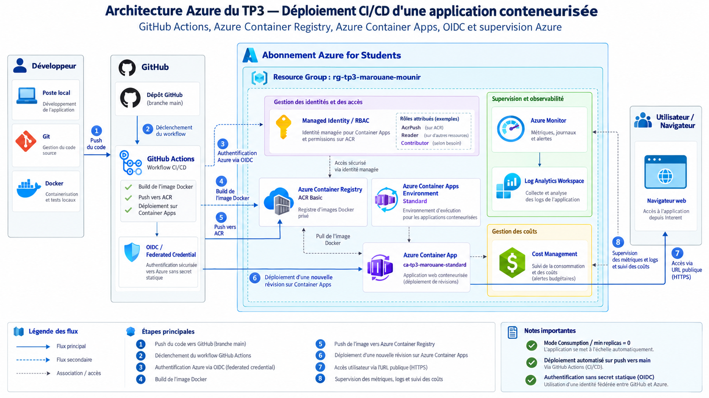

# Azure Cloud-Native CI/CD Pipeline

**End-to-end DevOps automation using GitHub Actions, Docker, Azure Container Registry, and Azure Container Apps.**

   

## Overview

This project demonstrates the design and implementation of a **secure, automated CI/CD pipeline on Microsoft Azure**.

A containerized Nginx web application is automatically built, pushed to Azure Container Registry (ACR), and deployed to Azure Container Apps whenever new code is pushed to the `main` branch.

The solution follows modern DevOps principles, including Infrastructure as a Service abstraction, Pipeline as Code, automated deployments, identity-based authentication, least-privilege access, and cloud cost optimization.

## Architecture



The architecture consists of the following components:

| Component | Technology | Purpose |
|---|---|---|
| Source Control | GitHub | Version control and collaboration |
| CI/CD | GitHub Actions | Automated build and deployment |
| Containerization | Docker | Application packaging |
| Container Registry | Azure Container Registry | Private Docker image storage |
| Hosting | Azure Container Apps | Serverless container hosting |
| Authentication | OIDC | Passwordless GitHub-to-Azure authentication |
| Authorization | Azure RBAC | Least-privilege resource access |
| Runtime Security | Managed Identity | Secure image pulling from ACR |
| Monitoring | Azure Monitor | Application metrics and monitoring |
| Cost Management | Azure Cost Management | Resource cost tracking |

### CI/CD Workflow

```text
Developer
    |
    | git push (main)
    v
GitHub Repository
    |
    v
GitHub Actions
    |
    |-- Checkout source code
    |-- Validate application files
    |-- Authenticate to Azure using OIDC
    |-- Build Docker image
    |-- Tag image with Git commit SHA
    |-- Push image to Azure Container Registry
    |-- Deploy new Azure Container Apps revision
    |-- Verify deployed image
    |
    v
Azure Container Apps
    |
    | HTTPS
    v
Web Application
```

## Key Features

- **Automated CI/CD:** Every push to `main` triggers the deployment workflow.
- **Secure OIDC authentication:** No long-lived Azure client secrets stored in GitHub.
- **Immutable image tagging:** Each Docker image is tagged with its Git commit SHA for traceability.
- **Private container registry:** Docker images are stored in Azure Container Registry.
- **Serverless deployment:** Azure Container Apps runs the application using the Consumption workload profile.
- **Managed Identity:** The application securely pulls images from ACR without registry administrator credentials.
- **Least-privilege RBAC:** Deployment and registry permissions are scoped to the required Azure resources.
- **HTTPS ingress:** The web application is exposed through a managed HTTPS endpoint.
- **Cost optimization:** Scale-to-zero configuration reduces idle compute consumption.

## Technology Stack

| Category | Technologies |
|---|---|
| Cloud | Microsoft Azure |
| Containerization | Docker, Nginx |
| CI/CD | GitHub Actions, YAML |
| Cloud Services | Azure Container Registry, Azure Container Apps |
| Security | Microsoft Entra ID, OIDC, Azure RBAC, Managed Identities |
| Automation | Azure CLI, PowerShell, Git |
| Monitoring | Azure Monitor, Cost Management |

## Repository Structure

```text
.
├── .github/
│   └── workflows/
│       └── azure-deploy.yml
├── Dockerfile
├── index.html
├── Jenkinsfile
├── docs/
│   └── TP3-Azure/
│       ├── architecture/
│       ├── rapport/
│       └── screenshots/
└── README.md
```

The `Jenkinsfile` originates from an earlier Docker and Jenkins exercise, while `azure-deploy.yml` implements the Azure deployment pipeline.

## How the Pipeline Works

### 1. Source Code Changes

The developer modifies the application and pushes changes to the `main` branch.

```bash
git add .
git commit -m "feat: update application"
git push origin main
```

### 2. GitHub Actions Trigger

GitHub Actions automatically starts the workflow defined in:

`.github/workflows/azure-deploy.yml`

### 3. Azure Authentication

GitHub Actions authenticates to Microsoft Azure using **OpenID Connect (OIDC)** and a federated credential associated with a dedicated Azure managed identity.

This avoids storing long-lived Azure service principal passwords.

### 4. Docker Build and Push

The pipeline builds a Docker image and tags it with the current commit SHA.

```bash
docker build -t <registry-login-server>/tp3-azure:<commit-sha> .
docker push <registry-login-server>/tp3-azure:<commit-sha>
```

### 5. Automated Deployment

GitHub Actions updates the Azure Container App to use the newly published image.

```bash
az containerapp update \
  --name ca-tp3-marouane-standard \
  --resource-group rg-tp3-marouane-mounir \
  --image <registry-login-server>/tp3-azure:<commit-sha>
```

Azure Container Apps creates a new application revision to apply the deployment.

## Security

The project implements two separate managed identities.

**Deployment identity**

Used by GitHub Actions to authenticate to Azure through OIDC.

Permissions:

- `AcrPush` and `Reader` on Azure Container Registry.
- `Contributor` scoped to the target Azure Container App.

**Runtime identity**

Used by Azure Container Apps to retrieve private container images from ACR.

Permission:

- `AcrPull` on Azure Container Registry.

This separation follows the principle of least privilege.

The GitHub Actions workflow uses the repository secrets `AZURE_CLIENT_ID`, `AZURE_TENANT_ID`, and `AZURE_SUBSCRIPTION_ID` as identity configuration values, not as Azure passwords.

## Validation and Results

The implementation was successfully validated through an end-to-end CI/CD test.

| Validation | Result |
|---|---|
| Local Docker build | Passed |
| Nginx application test | Passed |
| ACR image push | Passed |
| Azure Container Apps deployment | Passed |
| GitHub OIDC authentication | Passed |
| Automated GitHub Actions workflow | Passed |
| Automated redeployment after Git push | Passed |
| HTTPS access | Passed |

A modification to `index.html` triggered a new pipeline execution, built a new Docker image, published it to ACR, and updated the web application on Azure.

## Monitoring and Cost Optimization

The project uses Azure Container Apps with a Consumption workload profile.

Configuration:

- Minimum replicas: `0`
- Maximum replicas: `1`
- HTTPS ingress enabled
- Azure monitoring and cost analysis

At the time of the academic cost review, Azure Cost Management reported approximately **$0.05 USD** in accumulated costs. This represents a historical snapshot rather than a permanent operating cost.

Note that Azure Container Registry Basic may continue to generate charges while the registry exists, even when the Container App is stopped.

## Challenges and Lessons Learned

During implementation, several cloud engineering challenges were encountered and resolved:

- Azure resource provider registration and quota restrictions.
- Azure Container Apps Express versus Standard environment limitations.
- Managed Identity and Azure RBAC configuration.
- GitHub OIDC federated credential subject mismatch.
- Registry permissions and Azure CLI resource discovery.
- End-to-end CI/CD verification and deployment troubleshooting.

These challenges provided practical experience in cloud identity management, container deployment, pipeline debugging, and cost-aware infrastructure management.

## Documentation

Detailed architecture diagrams, academic reports, and deployment screenshots can be found in the `docs/TP3-Azure/` directory when added to the repository.

## Author

**Marouane Mounir**

Computer Engineering Student — Big Data & Cloud Computing  
ENSET Mohammedia, Hassan II University of Casablanca

[GitHub](https://github.com/Marouanemounir)